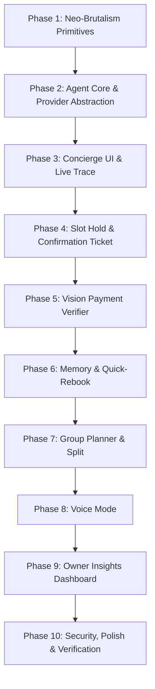

# PlaySphere AI - AI Concierge & Neo-Brutalism Agent Upgrade Plan

**Project:** PlaySphere AI (APL 2026 3rd Rank, GDG Lucknow DevFest Showcase)  
**Target:** Transform AI Concierge into a tool-using server-side AI Agent with Neo-Brutalism UI  
**Design Reference:** Mobile Neo-Brutalism mockups (Chat, Agent Trace, Booking Draft, Payment Verifier, Group Planner, Voice Mode, Owner Insights)

---

## 1. Codebase Audit Summary

### 1.1 Architecture & Stack
- **Framework:** Next.js 16.2.6 (App Router + Turbopack), React 19.2.4, TypeScript 5.
- **Styling:** Tailwind CSS 4 (`@theme` in `globals.css`), Lucide icons, Framer Motion.
- **Fonts (configured in `layout.tsx`):** Space Grotesk (`--font-space`), Space Mono (`--font-space-mono`), Bebas Neue (`--font-bebas`), Inter (`--font-inter`).
- **Database & Auth:** Firebase Auth (client & admin), Cloud Firestore (`backend/firebase/firestore.ts`, `backend/firebase/admin.ts`).
- **Maps & Discovery:** Google Maps API, Overpass OSM discovery for public sports infrastructure in Lucknow.

### 1.2 Active AI Provider & Gap Analysis
- **Current State:** UI copy cites "Powered by Gemini", but `backend/ai/llm.ts` calls a generic OpenAI-compatible completions endpoint defaulting to Groq (`https://api.groq.com/openai/v1`, model `qwen/qwen3.8-27b`). No direct Ollama code is present.
- **Concierge Flow:** Currently a 2-pass prompt-based query parser that does client-filtered rankings. It cannot invoke tools, hold slots, create booking drafts, or stream step-by-step agent reasoning.
- **Target State:** Unified server-side provider abstraction (`backend/ai/provider.ts` / `lib/ai/provider.ts`) supporting **Google Gemini** (Gemini 2.5 Flash / 1.5 Flash with native function calling + multimodal vision for payment verification), with runtime fallback to Groq/Ollama via `AI_PROVIDER` env variable.

### 1.3 Booking & Payment Lifecycle
- **Slots:** Generated via `generateTimeSlots()` with time-of-day peak multipliers (morning 1.0x, afternoon 0.85x, evening 1.3x) and past-slot validation (`isSlotInPast()`).
- **Bookings:** Created with status `pending`, payment status `payment_pending`.
- **Payment Verification:** Manual UPI screenshot upload + UTR; owner manually reviews in `/owner` and clicks "Verify & Approve" which generates a ticket ID (`PS-BAD-2026-XXXX`).
- **Target Upgrade:**
  1. Temporary slot holds (drafts) with 10-minute TTL countdown.
  2. The user explicitly clicks "Confirm Booking" to create the actual booking.
  3. AI Payment Verifier using Gemini Vision to extract UTR, amount, time, and payee, matching with booking data and presenting Match/Mismatch confidence to the owner.

### 1.4 Firestore Collections & Proposed Additions
- **Existing Collections:** `users`, `venues`, `bookings`, `landmarks`, `infrastructure`, `ownership_requests`, `system_settings`.
- **New Collections / Sub-collections:**
  - `slot_holds`: Temporary slot reservations (`venueId`, `date`, `slot`, `playerId`, `expiresAt`, `status: 'active' | 'confirmed' | 'released'`).
  - `user_memories`: Personalization memory (`uid`, `favoriteSports`, `usualArea`, `budgetRange`, `preferredTimes`, `lastBookedVenueId`, `historySummary`, `updatedAt`).
  - `group_plans`: Group bookings & invite links (`planId`, `venueId`, `venueName`, `date`, `slot`, `creatorId`, `requiredPlayers`, `participants`, `splitAmount`, `status`).
  - `agent_audit_logs`: Audit trace of tool invocations for security and safety tracking.
- **Firestore Rules Update:** Protect `slot_holds`, `user_memories`, and `group_plans` with strict owner and authenticated user rules.

---

## 2. Neo-Brutalism Design System Specifications

### 2.1 Tokens & Visual Rules
- **Borders:** `3px solid #000000` (Light mode) / `3px solid #334155` or `#000000` (Themed Dark mode).
- **Shadows:** Hard offset shadows with NO blur:
  - Base: `6px 6px 0px #000000` (or `4px 4px 0px #000000` for smaller cards).
  - Hover: `3px 3px 0px #000000` with `translate(3px, 3px)`.
  - Active: `0px 0px 0px #000000` with `translate(6px, 6px)`.
- **Palette (Flat & Saturated):**
  - Cream Background: `#FFF8E7` (`--neo-cream`)
  - Deep Black: `#0A0A0A` (`--neo-black`)
  - Yellow: `#FFE14D` (`--neo-yellow`)
  - Pink: `#FF6B9D` (`--neo-pink`)
  - Mint: `#4ADE80` (`--neo-mint`)
  - Sky: `#60A5FA` (`--neo-sky`)
  - Orange: `#FF8A3D` (`--neo-orange`)
  - Red: `#FF4D4D` (`--neo-red`)
- **Typography:**
  - Headings & Titles: Space Grotesk / Bebas Neue, uppercase, bold tracking.
  - Numbers, IDs, UTR, Timers: Space Mono (`font-mono`).
  - Body: Space Grotesk.
- **Stickers & Badges:** Rotated sticker badges (`-rotate-2`, `rotate-3`, `rotate-6`), sharp or max `6px` radius, no blur, no glassmorphism.
- **Accessibility:** Minimum 44px touch targets on mobile, high-contrast text, visible focus rings, `prefers-reduced-motion` respected.

---

## 3. Phase-by-Phase Implementation Plan

---

### Phase 1: Neo-Brutalism Design System Primitives
- **Scope:** Build the reusable Neo-Brutalist component library and Tailwind theme tokens matching the design mockups.
- **Components to Create (`frontend/src/components/neo/`):**
  - `NeoButton.tsx`: Variants (`primary`, `accent`, `mint`, `pink`, `yellow`, `outline`, `danger`), size options, hover shrink & press states.
  - `NeoCard.tsx`: Card container with 3px border, 6px 6px hard shadow, optional tilted sticker badge slot.
  - `NeoBadge.tsx`: Sticker badges with rotation variants (`rotate-left`, `rotate-right`, flat) and theme color presets.
  - `NeoInput.tsx`: Thick-border input and textarea with high-contrast active state and mono support.
  - `NeoModal.tsx` & `NeoSheet.tsx`: Modal dialogs and bottom sheets (mobile) / side drawers (desktop) with backdrop and hard borders.
  - `NeoToast.tsx`: Notification alerts in bold Neo-Brutalist styling.
- **Files Modified:** `frontend/src/app/globals.css`, `frontend/tailwind.config.*` (or Tailwind v4 `@theme`).
- **Risks:** Conflicts with existing soft-UI styling; solved by encapsulating Neo primitives and styling components modularly.
- **Test Checklist:** Primitives render cleanly in both light (`#FFF8E7` cream) and dark modes, mobile responsive down to 360px, buttons click with 3D press effect.

---

### Phase 2: Agent Core (Provider Abstraction, Tools, Server Loop)
- **Scope:** Create a server-side AI Agent with function calling, tool execution loop, rate limiting, and provider abstraction.
- **Files to Create:**
  - `backend/ai/provider.ts`: Provider abstraction with support for `gemini` (Gemini 2.5 Flash / 1.5 Flash via `@google/genai` or direct API), `groq`, and `ollama`. Configurable via `AI_PROVIDER` env variable.
  - `backend/ai/tools/`:
    - `searchVenues.ts`: Reads live approved venues from Firestore matching sport, area, price, rating.
    - `getVenueDetails.ts`: Reads complete venue profile, amenities, pricing, rules.
    - `getAvailableSlots.ts`: Returns live slots for a venue & date, filtering out existing bookings and active slot holds.
    - `createBookingDraft.ts`: Creates a 10-minute temporary hold in `/slot_holds` (never creates a confirmed booking!).
    - `getUserPreferences.ts`: Reads user memory / preferences.
    - `suggestAlternatives.ts`: Finds next-best slots or nearby venues if preferred slot is occupied.
    - `calculateSplit.ts`: Calculates per-person UPI split for group bookings.
  - `backend/ai/agent.ts`: Autonomous tool-calling loop (max 6 iterations, 30s timeout, safety guards against prompt injection, structured JSON trace emitter).
  - `frontend/src/app/api/ai/agent/route.ts`: Streaming SSE route for live chat and trace events. Verifies Firebase ID token server-side.
- **Files Modified:** `backend/firebase/admin.ts`, `.env.example`.
- **Risks:** Rate limits or tool loops; mitigated by maximum 6 steps, timeouts, and fallback responses.
- **Test Checklist:** Tools only query approved bookable venues (`bookable: false` OSM venues are rejected); token verification blocks unauthenticated requests.

---

### Phase 3: Concierge Chat UI & Live Agent Trace
- **Scope:** Redesign the AI Concierge chat in Neo-Brutalism style matching Reference Images 01 & 02, including the Live Agent Trace drawer/sheet.
- **Files to Create/Modify:**
  - `frontend/src/components/ai/NeoConciergeChat.tsx`: Full Neo-Brutalist chat interface with header sticker badges, yellow user bubbles, robot responses, venue recommendation cards with slot pills and "BOOK VIA AGENT →" button.
  - `frontend/src/components/ai/LiveAgentTrace.tsx`: Bottom sheet / side drawer ("AGENT KYA SOCH RAHA HAI") showing live step progress: tool name, running/done status, execution duration (`00:01.24`), and collapsible step inputs/outputs.
  - `frontend/src/components/ai/AIConciergePreview.tsx`: Updated to render `NeoConciergeChat` or toggle seamlessly.
- **Design Reference:** Image 01 (Chat) & Image 02 (Trace).
- **Test Checklist:** SSE stream updates live tool pills in real-time, trace drawer opens on mobile as bottom sheet and desktop as side drawer, zero hydration warnings.

---

### Phase 4: Booking Draft, Slot Hold, Confirmation Ticket & Autonomous Rebooking
- **Scope:** Build the booking hold countdown, perforated ticket card, explicit user confirmation modal, and autonomous rebooking suggestions.
- **Files to Create/Modify:**
  - `backend/firebase/slot-hold.ts`: Helper functions to create slot hold (`/slot_holds`), check hold collisions, and release expired holds automatically.
  - `frontend/src/components/booking/NeoBookingTicket.tsx`: Perforated Neo-Brutalist ticket card matching Image 03 ("BOOKING HOLD", venue photo, sport badge, Date/Time/Players/Total Price 2x2 grid, split box, live 10-min countdown timer `⏱ HOLD: 09:42`, "✔ CONFIRM BOOKING" and "CHANGE" buttons).
  - `frontend/src/app/api/bookings/confirm-draft/route.ts`: API to convert an active slot hold into a real Firestore booking (enforces user auth, no past slots, atomic validation).
  - `backend/ai/rebooking.ts`: Autonomous alternative proposer when a slot becomes unavailable or booking is cancelled.
- **Design Reference:** Image 03 (Booking Hold Ticket).
- **Test Checklist:** Timer counts down from 10:00; expiring hold frees slot; only explicit user click confirms booking; past slots rejected.

---

### Phase 5: Payment Verifier (Gemini Vision) + Owner Approval UI
- **Scope:** Multimodal UPI verification using Gemini Vision with Match/Mismatch detection and redesigned Owner Verification card.
- **Files to Create/Modify:**
  - `backend/ai/payment-verifier.ts`: Calls Gemini Vision to extract `{ amount, utrNumber, timestamp, payeeName }`, compares against target booking, flags duplicate UTRs across Firestore `/bookings`, and returns match confidence.
  - `frontend/src/app/api/owner/verify-payment-proof/route.ts`: Server-side endpoint protected by owner/admin role verification.
  - `frontend/src/components/owner/NeoPaymentVerificationCard.tsx`: Match Reference Image 04 ("PAYMENT VERIFICATION" header, side-by-side UPI screenshot with corner markers, extracted details table, tilted green "✔ MATCH" or red "✖ MISMATCH" badge, robot status message, APPROVE and REJECT buttons).
  - `frontend/src/app/owner/page.tsx`: Integrate the Neo-Brutalism verification modal/card.
- **Design Reference:** Image 04 (Payment Verification).
- **Test Checklist:** Valid UPI screenshot extracts correct UTR and amount; duplicate UTR is flagged; owner approval generates confirmed ticket ID.

---

### Phase 6: Memory & Personalization ("Hamesha Wala")
- **Scope:** User memory storage for favorite sports, usual area, budget, preferred times, and one-tap rebooking.
- **Files to Create/Modify:**
  - `backend/firebase/user-memory.ts`: CRUD operations for user memory stored in `/users/{uid}/memory` or `/user_memories/{uid}`.
  - `frontend/src/components/ai/UserMemoryManager.tsx`: Neo-Brutalism widget in player dashboard allowing user to view, edit, or click "Forget this" to delete all memory.
  - `backend/ai/tools/getUserPreferences.ts`: Injected into agent toolchain for personalized suggestions (e.g., "Hamesha wala Gomti Nagar badminton").
- **Test Checklist:** User can view and wipe memory; agent utilizes stored preferences when contextually appropriate.

---

### Phase 7: Group Planner & Per-Person Split
- **Scope:** Group planning flow with shareable invite link, RSVP tracking, players progress bar, and UPI split calculation.
- **Files to Create/Modify:**
  - `backend/firebase/group-planner.ts`: Group plan data model and Firestore operations.
  - `frontend/src/app/group/[id]/page.tsx` or `frontend/src/components/group/NeoGroupPlanner.tsx`: Match Reference Image 05 ("GROUP PLANNING", venue preview, copyable invite link `playsphere.ai/join/...`, segmented players progress bar "6 of 8 PLAYERS", participants list with JOINED/PENDING badges, payment split table with paid toggles, summary footer).
  - `backend/ai/tools/calculateSplit.ts`: Tool for agent to calculate split and suggest buddy matching when players are missing.
- **Design Reference:** Image 05 (Group Planning).
- **Test Checklist:** Copy link works; participant join updates progress bar; split calculation correctly computes per-person share.

---

### Phase 8: Voice Mode (Hinglish/Hindi/English)
- **Scope:** Voice input interface with live audio waveform animation, live transcript, and agent execution.
- **Files to Create/Modify:**
  - `frontend/src/components/ai/NeoVoiceModal.tsx`: Match Reference Image 06 ("VOICE MODE", "Bol do apni sports plan!", yellow mic card with burst accents, audio visualizer waveform, "LIVE TRANSCRIPT" card with pulsing "LISTENING..." badge, and red STOP button).
  - Web Speech API integration with fallbacks for unsupported browsers.
- **Design Reference:** Image 06 (Voice Mode).
- **Test Checklist:** Speech converts to text and dispatches to agent pipeline; graceful fallback if mic permission is denied.

---

### Phase 9: Owner Insights Dashboard & Advisory Suggestions
- **Scope:** Realtime analytics and AI business advisory cards for venue owners.
- **Files to Create/Modify:**
  - `backend/ai/owner-insights.ts`: Generates hourly booking stats, occupancy, revenue, peak hours, and heuristic/AI suggestions (e.g. underbooked slot discount, high-demand extra court).
  - `frontend/src/components/owner/NeoOwnerInsights.tsx`: Match Reference Image 07 ("VENUE OWNER DASHBOARD", stat cards OCCUPANCY 76%, REVENUE ₹28,800, PEAK HOURS 6-9 PM, hourly booking bar chart, AI suggestions with APPLY/DISMISS actions).
  - `frontend/src/app/owner/page.tsx`: Embed insights tab.
- **Design Reference:** Image 07 (Owner Insights).
- **Test Checklist:** Suggestions are strictly advisory; dismiss removes card; apply triggers owner action with confirmation.

---

### Phase 10: Security, Polish, Firestore Rules & Demo Seed Data
- **Scope:** Comprehensive audit of security rules, rate limits, audit logging, typecheck, ESLint, and DevFest demo seeds.
- **Tasks:**
  - Update `firestore.rules` to secure `slot_holds`, `group_plans`, `user_memories`.
  - Add safety chip to all agent UIs: *"Grounded in live venue data. Bookings need your confirmation."*
  - Run full test suite, `npm run build`, and verify zero hydration warnings.
  - Document setup and environment variables in `README.md`.

---

## 4. Definition of Done for Every Phase
1. `npm run build` passes with zero TypeScript errors and clean Next.js Turbopack output.
2. No console errors, no hydration warnings.
3. Mobile-first responsive (tested down to 360px) and dark/light theme compliant.
4. Non-negotiable rules respected (no hallucinated venues, no direct confirmed bookings without user click, server-side auth enforced).

